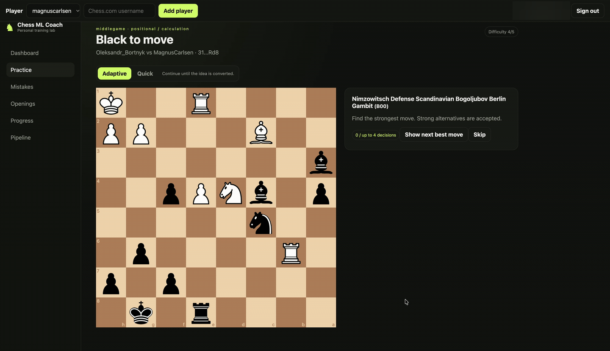

# Chess ML Coach

Turn mistakes from your Chess.com games into puzzles you can practice and revisit.

**[Open Chess Coach](https://chess-ml-coach.onrender.com)** · Hosted app requires email sign-in · [Run locally](#quick-start)



- **Practice your own mistakes.** Play an adaptive continuation or solve a one-move puzzle in Quick mode.
- **Understand the answer.** Review Stockfish's line and a board-based explanation after an attempt.
- **Build a practice routine.** Revisit due puzzles with spaced repetition and track progress by opening and motif.

Stockfish evaluates positions and supplies best moves. The local LightGBM model estimates which kinds of positions you tend to mishandle. The hosted browser pipeline uses a lightweight mistake-risk model.

## Quick start

Install Python 3.11+, Node.js 22+, and Stockfish. You’ll need internet access to import public Chess.com games.

```bash
git clone https://github.com/srbmaury/Chess-Coach.git
cd Chess-Coach
python -m venv .venv
source .venv/bin/activate
python -m pip install -e '.[dev]'
export STOCKFISH_PATH=/absolute/path/to/stockfish

cd web
npm ci
npm run build
cd ..
chess-coach ui
```

On Windows PowerShell, use `.\.venv\Scripts\Activate.ps1` to activate the environment and `$env:STOCKFISH_PATH = "C:\path\to\stockfish.exe"` to set the engine path.

1. Open [localhost:8000](http://127.0.0.1:8000) and add your Chess.com username with **Add player**.
2. In **Pipeline**, run **Sync → Analyze → Features → Puzzles** in order.
3. Open **Practice** to solve your first due puzzle. Run **Train → Report** in Pipeline when you want a personalized coaching report.

The first Stockfish analysis takes the longest. You can stop it from Pipeline and resume from its saved cache.

## How it works

Chess Coach imports games through Chess.com's public, read-only API. Stockfish evaluates the moves, and the pipeline uses the analysis to build a personal puzzle bank and extract features for the mistake-risk model. Practice results determine when each puzzle is due again.

## Local profiles

### Multiple players

Each username receives independent storage. Adding or switching a player never reuses another player's analysis or training history.

Example:

```text
data/
  users/
    alice/
      raw/
      processed/
      engine/
      training/training.db
    bob/
      raw/
      processed/
      engine/
      training/training.db

models/
  users/
    alice/
      mistake_model.joblib
      mistake_model.metadata.json
    bob/
      mistake_model.joblib
      mistake_model.metadata.json
```

The active profile is recorded locally in `data/profiles.json`. Usernames are validated and canonicalized before being used for filesystem paths.

A second repository clone is **not required** to test another Chess.com account. Use **Add player** / **Switch player** in the UI, or pass `--username` to CLI commands.

### Permanently delete a player's local data

Stop the web UI and any pipeline work first. Then delete one player's raw games,
processed datasets, Stockfish cache, puzzle/review/explanation history, trained
model, and local profile metadata:

```bash
chess-coach delete-user-data --username alice
```

The interactive command requires typing the canonical username exactly. For
non-interactive local scripts, explicitly bypass the prompt:

```bash
chess-coach delete-user-data --username alice --yes
```

Deletion is limited to that username's isolated directories. It refuses unknown
profiles and profiles with an active Stockfish analysis lock. This removes only
Chess ML Coach's local copies; it does not delete public games from Chess.com.

### Existing single-user installations

Older versions stored artifacts directly under:

```text
data/raw
data/processed
data/engine
data/training
models/mistake_model.*
```

On the first profile-aware command/startup, existing legacy artifacts are migrated to the configured/default player's profile (normally `srbmaury`) without rerunning Stockfish or retraining the model.

Migration is conservative:

- files are moved byte-for-byte, including `training.db` and its review/explanation history;
- already-migrated identical files are accepted;
- conflicting legacy/destination files stop migration with an error instead of being overwritten;
- the operation is safe to rerun after a partial migration.

### Stopping a long Stockfish analysis

While **Analyze** is running, the UI exposes **Stop analysis**. Cancellation is cooperative: the worker stops at a safe progress boundary rather than killing the process during a write.

Already completed analysis rows remain cached. Starting Analyze again resumes from the persisted cache instead of throwing away completed work.

Player switching is disabled while a pipeline job is running or stopping so a job cannot cross profile boundaries.

## CLI workflow

All CLI pipeline commands are profile-aware. `--data-dir` and `--model-dir` remain *root* directories; username scoping is applied beneath them automatically.

List the installed commands or inspect a command's exact options at any time:

```bash
chess-coach --help
chess-coach COMMAND --help
```

The complete command set is:

| Command | Purpose |
| --- | --- |
| `chess-coach sync` | Download and deduplicate Chess.com games. |
| `chess-coach analyze` | Run resumable full-game Stockfish analysis. |
| `chess-coach features` | Build the ML-ready feature dataset. |
| `chess-coach puzzles` | Build or refresh the personal puzzle bank. |
| `chess-coach train` | Train the personalized LightGBM model. |
| `chess-coach report` | Generate the coaching report. |
| `chess-coach practice` | Run the terminal one-move trainer. |
| `chess-coach progress` | Show review progress and recurring themes. |
| `chess-coach ui` | Start the local FastAPI + React application. |
| `chess-coach delete-user-data` | Permanently delete one local player's isolated data. |

There is no separate adaptive CLI command in V1. Adaptive continuation training runs in the web UI; terminal `chess-coach practice` intentionally retains the Quick one-move behavior.

For a particular Chess.com account:

```bash
chess-coach sync --username alice
chess-coach analyze --username alice
chess-coach features --username alice
chess-coach puzzles --username alice
chess-coach train --username alice
chess-coach report --username alice
```

Omitting `--username` uses the configured/default player.

### 1. Sync games

```bash
chess-coach sync
```

Sync is idempotent: known games are deduplicated, new games are added, and unavailable monthly Chess.com archives are skipped safely.

### 2. Analyze moves

```bash
chess-coach analyze
```

Optional controls:

```bash
chess-coach analyze \
  --stockfish-path /absolute/path/to/stockfish \
  --depth 14
```

Depth 14 is the default. Analysis is resumable, reports reused vs newly analyzed moves, and uses a single-writer guard for each profile's analysis cache. If the app quits unexpectedly (crash, force-quit) while analysis was running, the next `analyze` run automatically detects and clears that stale lock instead of requiring manual cleanup.

### 3. Build features

```bash
chess-coach features
```

Features include position complexity, material, pawn structure, king-safety proxies, opening metadata, phase, rating difference, time-control category, and the pre-move engine evaluation.

Post-move engine evaluation, centipawn loss, and final game result are excluded from predictive features to avoid target leakage.

`features` accepts the same `--inaccuracy-cpl`, `--mistake-cpl`, and `--blunder-cpl` overrides as `analyze`, letting you reclassify move quality from already-analyzed positions without rerunning Stockfish:

```bash
chess-coach features --inaccuracy-cpl 40 --mistake-cpl 90 --blunder-cpl 180
```

### 4. Train the personalized model

```bash
chess-coach train
```

The model estimates:

```text
P(significant mistake | position + this player's historical patterns)
```

The default significant-mistake target is CPL >= 100. Games are split chronologically at whole-game level to prevent train/test leakage between moves from one game.

### 5. Generate the coaching report

```bash
chess-coach report
```

The report highlights recurring weak contexts by color, opening, phase, time control, and model-derived risk signals, with sample-size guards for grouped statistics. Raise or lower the minimum sample size a grouped statistic needs before it's reported:

```bash
chess-coach report --min-group-size 15
```

The web UI's Dashboard page opens the generated report in a new browser tab when you click the **report** artifact.

## Personal puzzle training

Build or refresh the player's puzzle bank:

```bash
chess-coach puzzles
```

Puzzle generation reuses existing engine analysis and does not launch Stockfish. Rebuilding is idempotent: attempts, streaks, due dates, mastery, reviews, and cached explanations are preserved. Positions that are no longer eligible are retired from active practice without deleting their history.

Practice due puzzles in the terminal's Quick one-move flow:

```bash
chess-coach practice --limit 10
```

The spaced-repetition schedule is intentionally simple:

| Result / streak | Next review |
| --- | ---: |
| Incorrect | 1 day |
| 1 correct in a row | 3 days |
| 2 correct in a row | 7 days |
| 3 correct in a row | 14 days |
| 4+ correct in a row | 30 days |

A puzzle is considered mastered after four consecutive correct reviews. A later failure resets the streak. In Adaptive mode, the review is correct only when the whole required continuation is converted; recognizing the first move but missing a later continuation records one incorrect review.

Track progress:

```bash
chess-coach progress
```

### Adaptive and Quick web practice

The web Practice page opens in **Adaptive** mode. **Quick** preserves the existing one-move flow and records its review immediately after that move.

Adaptive mode evaluates a short continuation locally with Stockfish. The stored principal-variation move is accepted, and ordinary alternatives are also accepted when they lose no more than **30 centipawns**. When a forced win is a mate, an alternative must preserve a winning mate for the training side. A drill stops after conversion, a terminal board state, a quiet stable position, four accepted decisions, or eight plies.

An adaptive session records exactly one spaced-repetition review when it succeeds or fails. Abandoning it—by switching to Quick, skipping, or moving on—records no review. Active sessions are persisted in the current player's `training.db`, so refreshing the browser or restarting the application resumes the current position and already-played line without exposing the next expected move.

Stockfish is started lazily for an active adaptive drill and is closed at completion, abandonment, profile switch, or application shutdown. This per-session engine is independent of the full-game analyzer's single-writer lock and does not mutate `analysis.parquet`.

The Progress page keeps overall review accuracy unchanged and reports adaptive drills completed, conversion rate, continuation accuracy excluding each drill's first move, average accepted decisions, and average calculation depth separately.

## Why is this best?

The practice UI keeps the answer hidden until the player attempts the puzzle. After the attempt, **Why is this best?** lazily requests an explanation.

The first request for a position/depth may run Stockfish on that single position to obtain a short principal variation. Python then derives concrete board facts and produces a deterministic explanation. The engine-grounded result is cached in the player's own `training.db` for later requests.

If Stockfish is unavailable, practice still works and the explanation falls back to clearly labeled board-only facts. If a fresh engine run disagrees with the puzzle's stored best move, the app does not attach an unrelated principal variation; it asks the user to refresh the analysis pipeline instead.

## Suggested routine

```bash
# After playing new games
chess-coach sync
chess-coach analyze
chess-coach features
chess-coach puzzles

# Most days
chess-coach practice --limit 10
chess-coach progress

# Periodically
chess-coach train
chess-coach report
```

The expensive step is Stockfish analysis. At the same engine configuration, later runs mainly analyze newly synced moves.

## Configuration

Precedence is:

1. CLI option
2. environment variable
3. project default

Useful environment variables:

```text
CHESS_COACH_USERNAME
CHESS_COACH_DATA_DIR
CHESS_COACH_MODEL_DIR
STOCKFISH_PATH
CHESS_COACH_STOCKFISH_DEPTH
CHESS_COACH_MIN_GROUP_SIZE
CHESS_COACH_INACCURACY_CPL
CHESS_COACH_MISTAKE_CPL
CHESS_COACH_BLUNDER_CPL
```

Default CPL boundaries:

| Label | CPL |
| --- | ---: |
| Good | `< 50` |
| Inaccuracy | `50–99` |
| Mistake | `100–199` |
| Blunder | `>= 200` |

## Local and hosted modes

| Mode | Analysis | Data and access |
| --- | --- | --- |
| Local, the default for self-hosted development | Native Stockfish and LightGBM | Files and SQLite under the local profile. Binds to localhost by default. |
| Hosted | Stockfish WebAssembly and a lightweight model run in the browser | Email sign-in through Supabase. PostgreSQL and private object storage hold hosted data and analysis checkpoints. |

Hosted analysis is opt-in for operators. A browser can resume shared analysis from a saved checkpoint. The server validates game identity, structure, and move legality, and labels evaluations **community computed**.

See the [hosted browser analysis runbook](docs/hosted-browser-analysis-runbook.md) for configuration, migrations, authentication, and rollout. See the [auth email runbook](docs/auth-email-runbook.md) for email delivery setup.

### Stockfish license

The web build bundles [Stockfish.js](https://github.com/nmrugg/stockfish.js) 19.0.0
(`stockfish-19-lite-single.js`/`.wasm`) from the `stockfish` npm package, © the
Stockfish developers and Chess.com, licensed under the GNU GPL v3
(`web/node_modules/stockfish/Copying.txt`). The engine is served unmodified. Its
corresponding source is available from the upstream repository at tag `v19.0.0` and from
[official-stockfish/Stockfish](https://github.com/official-stockfish/Stockfish). Anyone
who distributes this web build must make that source available under the GPL on
request.

## Local-only privacy model

Personal data, PGNs, engine analysis, puzzle/review history, explanation cache, trained models, frontend dependencies/build output, and `.env` files are excluded from Git.

The application is intentionally local-first and binds to localhost by default. Local player profiles are filesystem namespaces, **not authenticated server accounts**. Do not expose the current server publicly or bind it to an external interface without adding authentication, authorization, remote-storage isolation, quotas, job scheduling, and a deployment security design.

## Frontend development

Build once, then run:

```bash
# terminal 1
chess-coach ui --no-open

# terminal 2
cd web
npm run dev
```

Vite proxies `/api` to the local FastAPI process. Development CORS accepts only local Vite origins.

## Development checks

Python:

```bash
ruff check src tests
pytest --cov=chess_ml_coach --cov-report=term-missing
```

Frontend:

```bash
cd web
npm install
npm run test:run
npm run build
```

Tests mock network and engine boundaries, so CI does not need a Chess.com account, live PubAPI calls, or a Stockfish binary.

## Next improvements

High-value follow-ups include:

- stronger tactical-motif classification;
- rolling 7/30/90-day improvement tracking;
- SHAP explanations for the personalized LightGBM risk model;
- richer board arrows, hints, and variation exploration;
- a playable sample puzzle for visitors before sign-in.
